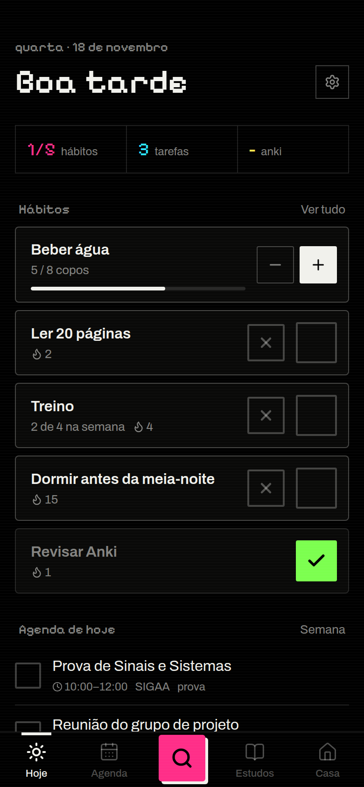
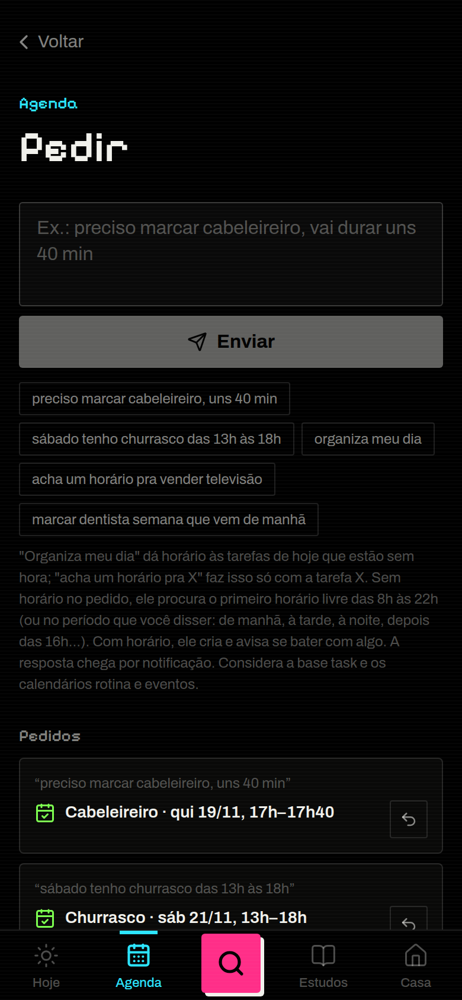
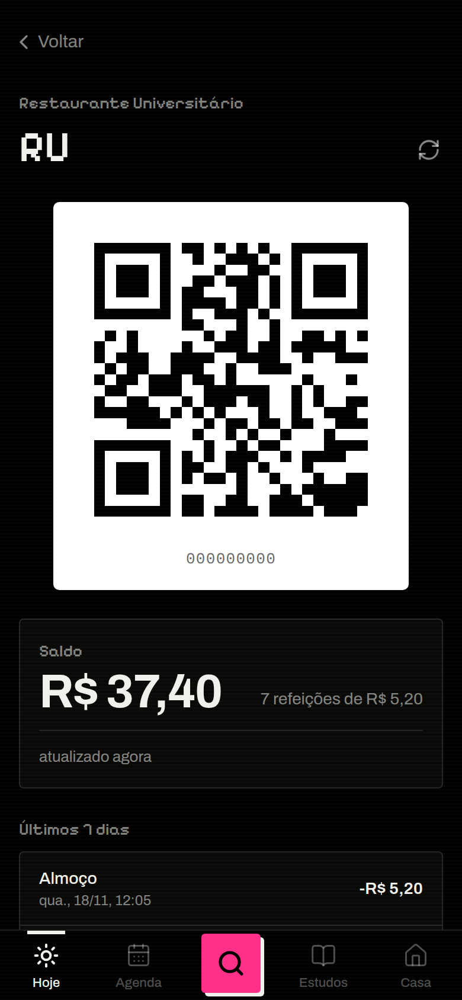
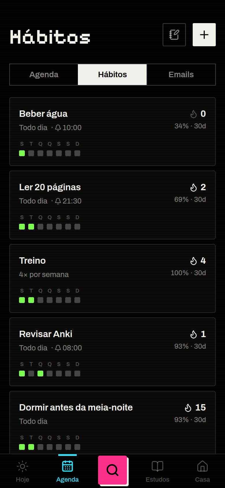
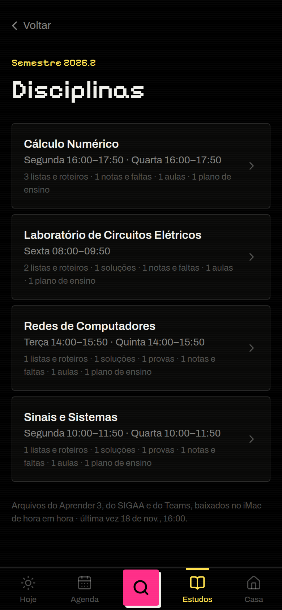
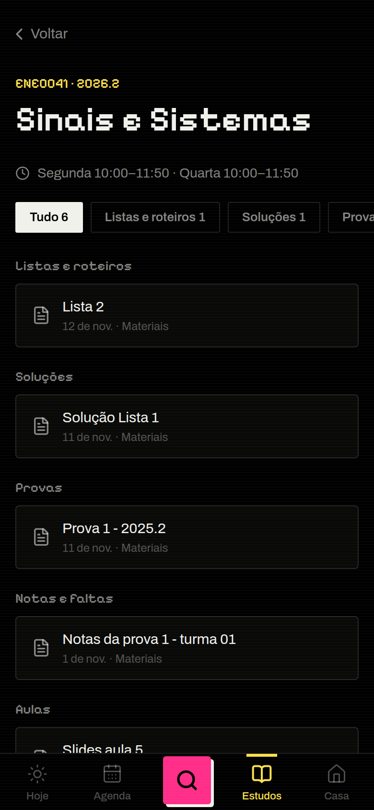
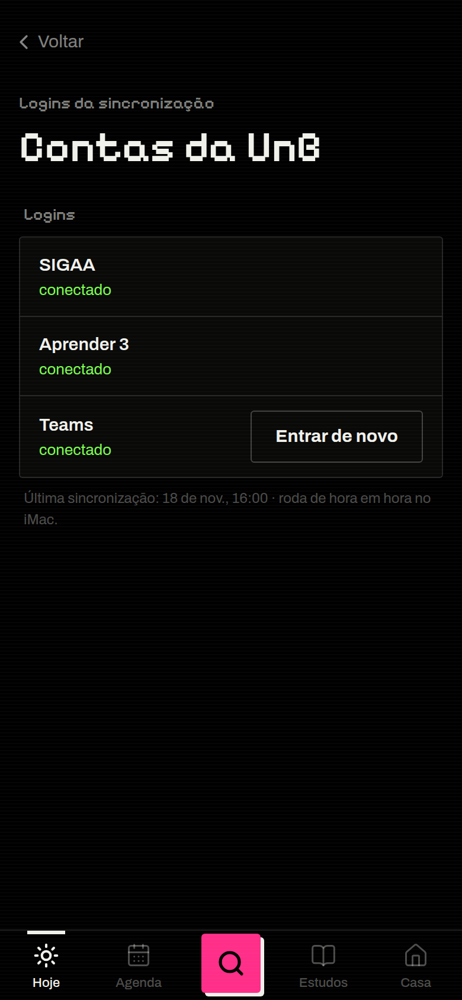
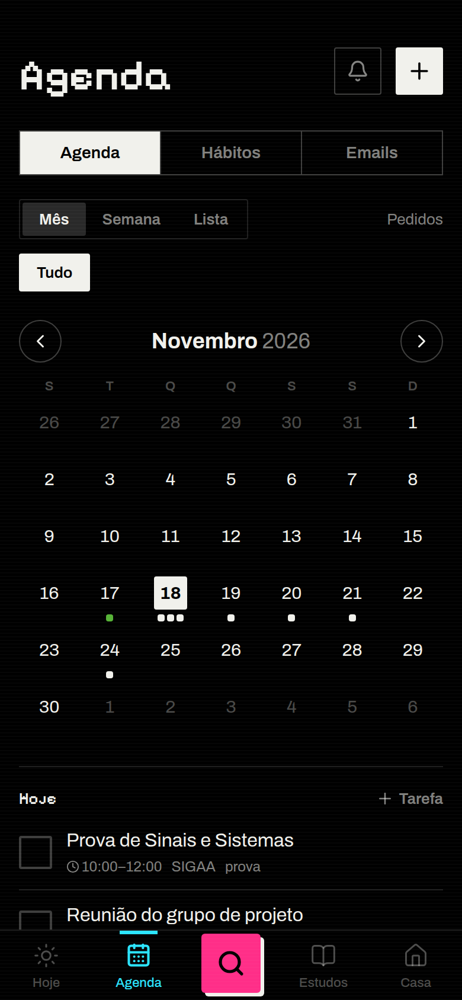
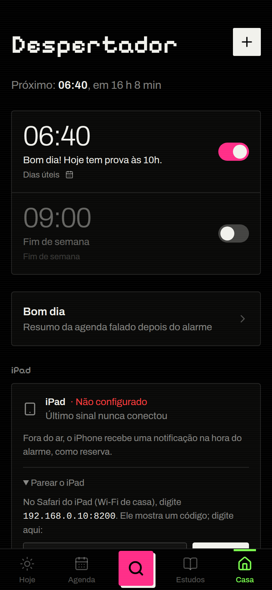
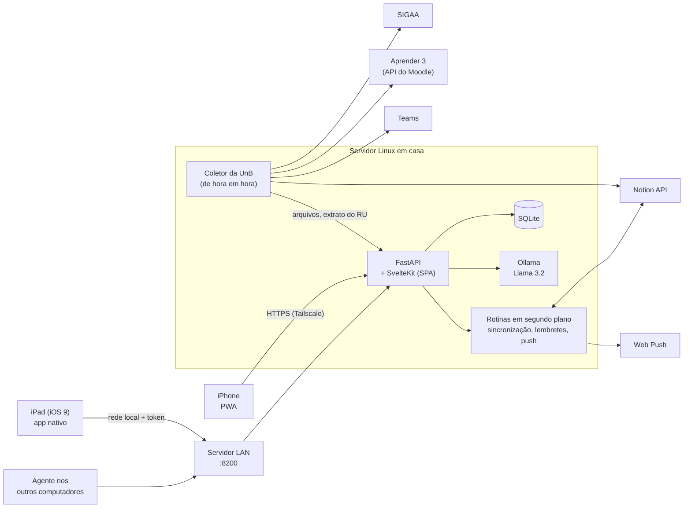

# Pursuit

Sistema pessoal de produtividade que eu uso todos os dias: hábitos, agenda com IA local,
integração completa com os sistemas da UnB e despertador falado, tudo num app instalado no celular
(PWA) e hospedado num servidor Linux na minha casa.

> As capturas de tela usam **dados fictícios**.

  
  
  
  

## Integração com a UnB

O Pursuit junta num app só o que fica espalhado entre SIGAA, Aprender 3, Teams e o Restaurante
Universitário. A coleta roda sozinha de hora em hora no servidor, sem ninguém logado.

- **SIGAA:** o SIGAA não tem API, então o sistema faz login pelo CAS da UnB, lê o portal do
  discente e sai da sessão. Traz horários e locais das turmas, notícias, arquivos das disciplinas
  e o extrato do RU.
- **Aprender 3 (Moodle):** usa a API oficial do app móvel do Moodle. Prazos de tarefas e
  questionários viram tarefas na agenda, e a tarefa é marcada como feita quando o Aprender 3
  confirma a entrega. Avisos dos professores também entram na agenda.
- **Teams:** baixa os arquivos das turmas. O login da Microsoft é feito pelo celular, com código
  de dispositivo, e o app avisa quando o login cai.
- **Disciplinas:** os arquivos das três plataformas ficam organizados por semestre e disciplina e
  são classificados automaticamente em listas, soluções, provas, notas, aulas e plano de ensino.
  Quando sai uma lista, prova ou nota nova, chega uma notificação.
- **RU:** saldo, extrato das refeições e o QR code da carteirinha para passar na catraca. O
  saldo aparece junto dos hábitos de refeição, com quantas refeições ainda cabem nele.
- **Contas da UnB:** uma tela mostra se cada login (SIGAA, Aprender 3 e Teams) está funcionando.
  Se algum falhar, chega um aviso no celular.

  
  
  

## Agenda integrada com IA local

A agenda é um espelho bidirecional de uma base do Notion, com visão de mês, semana e lista,
classificações editáveis e avisos antes de cada tarefa. Por cima dela roda uma **IA local**
(Ollama com Llama 3.2 3B, no próprio servidor e só em CPU), sem enviar nenhum dado para fora.

- **Pedidos em linguagem natural:** "preciso marcar cabeleireiro, uns 40 min" encontra o primeiro
  horário livre e cria a tarefa; "sábado tenho churrasco das 13h às 18h" cria e avisa se bater com
  outro compromisso; "organiza meu dia" dá horário às tarefas de hoje que estão sem hora. Cada
  pedido pode ser desfeito com um toque.
- **Leva em conta todos os calendários:** prazos da UnB, tarefas do Notion e calendários de rotina
  e eventos.
- **Triagem de e-mails:** a IA classifica cada e-mail (compromisso, prazo, precisa responder ou só
  informação). Prazos viram tarefas, boletos viram lembretes de pagamento e e-mails de pessoas
  esperando resposta entram numa lista.
- **Bom-dia falado:** depois do alarme, a IA reescreve o resumo da agenda do dia num tom natural.

**Como a IA é mantida sob controle:**

- **Código determinístico** interpreta dia, hora, duração e período. Modelos pequenos erram datas,
  então a IA nunca decide quando algo acontece.
- **A IA** só faz o que modelos de linguagem fazem bem: dar um título curto, estimar uma duração
  quando o pedido não diz, classificar e-mails e reescrever textos.
- **Saída estruturada:** as respostas seguem um esquema JSON fixo, validado pelo código.
- **Verificador:** o bom-dia é conferido contra os fatos da agenda. Se aparecer um número, dia ou
  atividade que não existe, ou se faltar alguma atividade, o sistema tenta de novo e, na segunda
  falha, usa um texto fixo. Na triagem, o trecho com a data precisa existir literalmente no
  e-mail. Assim a IA nunca inventa um compromisso.

  

## Hábitos e despertador

- **Hábitos:** marcação diária ou por quantidade, metas semanais, sequência (streak), lembretes
  por notificação e revisão no fim do dia.
- **Despertador falado:** alarmes tocam num iPad antigo da casa, com voz sintetizada. Se o iPad
  estiver fora do ar, o celular recebe uma notificação de reserva.
- **Outras integrações:** Anki, câmera USB com importação automática para o Immich e
  monitoramento dos computadores da casa.

  

## Arquitetura

| Camada | Tecnologias |
| --- | --- |
| Backend | Python, FastAPI, SQLAlchemy, Alembic, SQLite, pytest |
| Frontend | SvelteKit (SPA), TypeScript, Tailwind CSS, PWA com Web Push (VAPID) |
| Integrações | SIGAA (web scraping com sessão CAS), API do Moodle, Microsoft (login por código de dispositivo), Notion API, IMAP |
| IA | Ollama, Llama 3.2 3B (local), saída estruturada em JSON Schema |
| App do iPad | Objective-C, UIKit, Theos (alvo iOS 9, armv7) |
| Infraestrutura | Linux, systemd de usuário, Tailscale, polkit, backups automáticos |

## Decisões técnicas

- **Rede privada em vez de login:** o app só é acessível pela tailnet do Tailscale, com HTTPS.
  O iPad, que não roda Tailscale, fala com uma porta separada da rede local, autenticada por
  token e limitada às rotas de que ele precisa.
- **Segredos fora do repositório:** chaves e credenciais ficam em arquivos com permissão 600 no
  servidor. O token do Aprender 3 é gerado uma vez e a senha não é guardada. O Pursuit nunca vê a
  senha nem o token da Microsoft.
- **Um coletor só para a UnB:** um único processo fala com SIGAA, Aprender 3 e Teams e grava os
  resultados. O Pursuit só lê, então uma mudança no SIGAA quebra um lugar só. Falhas de login
  viram aviso no celular.
- **Notion como fonte da agenda:** sincronização nos dois sentidos com polling. Quando há
  conflito, vence a última edição. A agenda continua funcionando com o espelho local se a API
  cair.
- **Deploy contínuo simples:** um timer do systemd faz `git pull` a cada 5 minutos, recompila só o
  que mudou, roda as migrações e reinicia o serviço. Há backup diário do banco e uma cópia
  semanal em outra máquina.
- **Hardware antigo como restrição de projeto:** o servidor é um iMac de 2011 sem AVX2 (o build
  do frontend usa o binding WASI do bundler) e o iPad roda iOS 9 (app nativo em Objective-C
  compilado com Theos).

## Números

- Cerca de 9 mil linhas de Python no backend e 9 mil de TypeScript/Svelte no frontend.
- 125 testes automatizados (pytest).
- Em desenvolvimento desde novembro de 2026.

## Autor

Guilherme De Avila e Carvalho, estudante de Engenharia de Computação na UnB.
[LinkedIn](https://www.linkedin.com/in/guilherme-de-avila-e-carvalho-12a613214)
